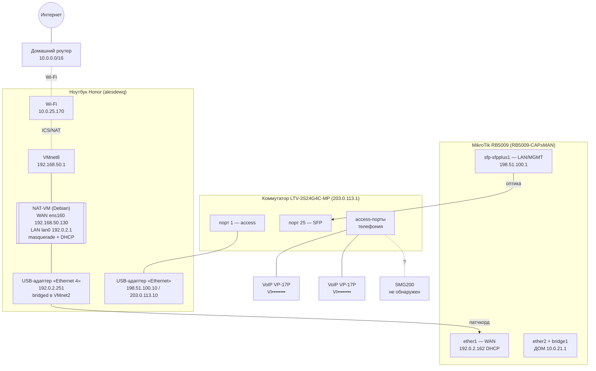

# Network Architecture — As-Built

> ⚠️ **Документ санитизирован для публичного репозитория.** Реальные подсети заменены на документационные диапазоны RFC 5737 (`192.0.2.0/24`, `198.51.100.0/24`, `203.0.113.0/24`) и `10.0.x` для домашних; MAC показаны только vendor-OUI; серийные номера устройств скрыты. Соответствие реальным адресам хранится офлайн.

> Снимок текущего состояния сети на **2026-10-23**. Собран только чтением (read-only), ничего на устройствах не менялось. Документ предназначен для аудита вторым архитектором и планирования дальнейших шагов.

**Легенда доступа при сборе:** MikroTik — полный доступ (SSH); Honor/Acer — полный доступ (SSH); LTV — опознан, но без учётных данных управления; SMG200 — не обнаружен на доступных подсетях.

---

## 1. Топология (физические связи)

Целевая логика трафика: **Honor Wi-Fi → виртуалка NAT (главный шлюз) → MikroTik → LTV → абоненты/телефоны**.



**Словами:**
- **Honor «Ethernet 4»** (192.0.2.251, USB GbE) ↔ патчкорд ↔ **MikroTik ether1** (WAN). Этот же адаптер через мост VMware **VMnet2** соединён с **NAT-VM** (`lan0` = 192.0.2.1). То есть ether1 MikroTik и NAT-VM — в одном L2-сегменте 192.0.2.0/24.
- **MikroTik sfp-sfpplus1** (198.51.100.1) ↔ оптика ↔ **LTV порт 25 (SFP)**.
- **LTV порт 1** ↔ **Honor «Ethernet»** (198.51.100.10 / 203.0.113.10) — через него же доступно управление самим LTV (203.0.113.1).
- **NAT-VM** выходит в интернет: `ens160` (VMnet8, 192.168.50.130) → Honor VMnet8 (192.168.50.1) → ICS/Wi-Fi Honor (10.0.25.170) → домашний роутер → интернет.
- **Телефоны VP-17P** (2 шт.) подключены к access-портам LTV, видны с MikroTik по LLDP (caps: bridge, telephone), но IP не получили.
- **Acer «Ethernet 6»** (192.0.2.252) — сейчас **отключён**: его USB-адаптер переставлен в ether1 MikroTik.

---

## 2. Матрица IP-подсетей

| Подсеть | Роль | Шлюз | Ключевые адреса |
|---|---|---|---|
| `10.0.25.0/24` | Домашний Wi-Fi (аплинк Honor) | домашний роутер | Honor Wi-Fi `10.0.25.170` |
| `192.168.50.0/24` | WAN NAT-VM (VMnet8 на Honor) | Honor VMnet8 `192.168.50.1` | NAT-VM `ens160 192.168.50.130` |
| `192.0.2.0/24` | **Транзит лаборатории** (NAT-VM ↔ WAN MikroTik) | NAT-VM `192.0.2.1` | Honor Eth4 `.251`, MikroTik ether1 `.162`, Acer Eth6 `.252` (down) |
| `198.51.100.0/24` | **LAN/MGMT** (MikroTik SFP ↔ LTV ↔ Honor) | MikroTik `198.51.100.1` | MikroTik sfp `.1`, Honor Eth `.10` |
| `203.0.113.0/24` | Управление коммутатором LTV | — | LTV `.1`, Honor Eth `.10` |
| `10.0.21.0/24` | **ДОМ** LAN + CAPsMAN (не трогаем) | MikroTik bridge1 `.1` | MikroTik ether2 `.88`/`.188` |
| `10.0.20.0/24` | Домашняя (DHCP-сеть задана на MikroTik) | `.1` | — |
| `10.0.5.0/24` | Домашний проводной (Acer PCIe) | домашний роутер | Acer Eth `.109` |
| *voice VLAN?* | VoIP VP-17P + SMG200 | **неизвестно** | 2 телефона, SMG200 (не найден) |

### VLAN
- **MikroTik:** VLAN-интерфейсов **нет** (`/interface vlan` пуст), `vlan-filtering=no` на обоих мостах. Сегментация LAN ещё не сделана.
- **LTV:** список VLAN/роли портов (trunk/access/native) и MAC-таблица **не собраны** — нет учётных данных управления. На LTV открыты SSH (dropbear 0.52), Telnet (23), Web (80).

---

## 3. Маршрутизация и NAT (MikroTik RB5009)

**Устройство:** RB5009UPr+S+, RouterOS 7.18.2, identity `RB5009-CAPsMAN`, uptime ~1.5 ч.

### Интерфейсы и адреса
| Интерфейс | MAC | Адрес(а) | Роль |
|---|---|---|---|
| `ether1` | 04:F4:1C:xx:xx:xx | `192.0.2.162/24` (DHCP) | **WAN** → NAT-VM |
| `sfp-sfpplus1` | 04:F4:1C:xx:xx:xx | `198.51.100.1/24` | **LAN/MGMT** → LTV |
| `ether2` | 04:F4:1C:xx:xx:xx | `10.0.21.88/24`, `10.0.21.188/24` | ДОМ |
| `bridge1` (ether3–8) | 04:F4:1C:xx:xx:xx | `10.0.21.1/24` | ДОМ + CAPsMAN DHCP |
| `bridge2` + `cap-wifi1..4` | 8A:A0:B1:xx:xx:xx | — | радиоинтерфейсы CAPsMAN |

### Таблица маршрутизации
| Назначение | Шлюз | Тип |
|---|---|---|
| `0.0.0.0/0` | `192.0.2.1` | DHCP, active (через WAN/NAT-VM) |
| `198.51.100.0/24` | sfp-sfpplus1 | connected |
| `192.0.2.0/24` | ether1 | connected |
| `10.0.21.0/24` | bridge1 | connected |

### NAT
```
chain=srcnat action=masquerade out-interface=ether1   # LAN->WAN via NAT-VM
```
Весь трафик, уходящий через ether1, прячется за WAN-адресом MikroTik (`192.0.2.162`), далее NAT-VM повторно NAT-ит его наружу (**двойной NAT — by design**).

### Firewall (input)
1. `accept established,related` ← добавлено, чтобы проходили ответы на запросы роутера
2. `accept src 10.0.21.44`
3. `accept src 10.0.21.144`
4. `accept src 198.51.100.0/24 in-interface=sfp-sfpplus1` (MGMT)
5. `drop` (всё остальное)

### DHCP (сервер — только домашняя сторона, не трогаем)
| Сервер | Интерфейс | Пул | Сеть |
|---|---|---|---|
| `dhcp-points` | bridge1 | `pool-points` `10.0.21.100–200` | `10.0.21.0/24` gw `.1`, `10.0.20.0/24` gw `.1`, DNS `8.8.8.8` |

**DHCP-клиент:** `ether1` = bound (`192.0.2.162`, `use-peer-dns=no`).

### DNS
Серверы **не заданы** (`/ip dns` пуст, `use-peer-dns=no`) — разрешение имён на самом роутере и для будущих LAN-клиентов не работает.

---

## 4. Телефония (SMG200)

**SMG200 на доступных подсетях (`203.0.113.0/24`, `198.51.100.0/24`) не обнаружен** — вероятно, находится в голосовом VLAN за LTV, куда сейчас нет маршрута. Поэтому IP интерфейсов, DHCP-пул, SIP-профили и абоненты **не собраны** (нужен доступ к SMG200 или к LTV для определения VLAN/порта).

Что удалось зафиксировать косвенно — через LLDP с MikroTik (sfp-sfpplus1):

| Устройство | MAC | Identity | Прошивка | Возможности |
|---|---|---|---|---|
| VoIP-телефон | EC:B1:E0:xx:xx:xx | `VP-17P-VI••••••••` | 1.5.6-b46 | bridge, telephone |
| VoIP-телефон | EC:B1:E0:xx:xx:xx | `VP-17P-VI••••••••` | 1.5.6-b46 | bridge, telephone |

Телефоны подключены к LTV, IP-адреса не получили (нет доступного DHCP в их сегменте).

---

## 5. Список текущих проблем и неизвестного

| # | Проблема / пробел | Детали | Что нужно |
|---|---|---|---|
| 1 | **Нет доступа к LTV** | опознан `LTV-3S24G4C-MP` (203.0.113.1), открыты SSH/Telnet/Web, но нет логина/пароля | учётные данные LTV → собрать VLAN, роли портов, MAC-таблицу |
| 2 | **SMG200 не найден** | не отвечает в `203.0.113.0/24` и `198.51.100.0/24` | IP + доступ SMG200, либо порт/VLAN на LTV, где он включён |
| 3 | **Телефоны без IP** | 2× VP-17P видны по LLDP, адресов нет | определить голосовой VLAN и источник DHCP для телефонии |
| 4 | **Нет DNS на MikroTik** | `/ip dns` пуст, `use-peer-dns=no` | задать `/ip dns` (`192.0.2.1` или публичный) — иначе LAN-клиенты без разрешения имён |
| 5 | **LAN не сегментирован** | на MikroTik нет VLAN, `vlan-filtering=no` | спроектировать VLAN'ы (ID/подсети) на SFP-порту в сторону LTV |
| 6 | **Дубли адресов на ether2** | `ether2` держит `10.0.21.88` и `.188`, пересекается с `bridge1 10.0.21.1`; в маршрутах видны неактивные дубликаты `10.0.21.0/24` через ether2 | проверить, не остаток ли это старой конфигурации |
| 7 | **Acer «Ethernet 6» завис в конфиге** | статик `192.0.2.252`, но адаптер физически отключён (переставлен в ether1) | убрать/переназначить, чтобы не путать схему |
| 8 | **Двойной NAT** | лаб → MikroTik (masq) → NAT-VM (masq) → дом | допустимо by design; учитывать при отладке сквозной связности |

---

## 6. Ноутбуки — текущая IP-адресация

### Honor (alesdewq)
| Интерфейс | MAC | IP | Назначение |
|---|---|---|---|
| «Ethernet» (Realtek 2.5GbE USB) | 44:65:E0:xx:xx:xx | `203.0.113.10`, `198.51.100.10` | в LTV порт 1 (LAN/MGMT) |
| «Ethernet 4» (Realtek USB GbE) | 00:E0:4C:xx:xx:xx | `192.0.2.251` | патчкорд в ether1 MikroTik + мост VMnet2 к NAT-VM |
| Wi-Fi | C8:6E:08:xx:xx:xx | `10.0.25.170` | домашний аплинк |
| VMnet8 / VMnet1 | — | `192.168.50.1` / `192.168.8.1` | VMware (WAN NAT-VM / host-only) |

### Acer (alesdewq2)
| Интерфейс | MAC | IP | Назначение |
|---|---|---|---|
| «Ethernet» (Realtek PCIe) | 04:55:B2:xx:xx:xx | `10.0.5.109` | домашний проводной |
| «Ethernet 6» (USB) | — | `192.0.2.252` | **отключён** (адаптер перенесён в ether1 MikroTik) |
| VMnet8 / VMnet1 | — | `192.168.40.1` / `192.168.229.1` | VMware (хост Kali) |
| happ-tun | — | `172.18.0.1/30` | прокси-туннель |

---

*Собрано автоматически (read-only). После публикации изменения в инфраструктуру не вносились — ждём обсуждения плана.*
